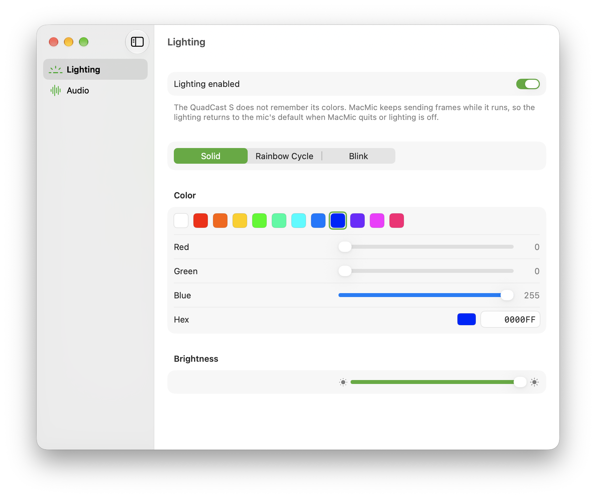
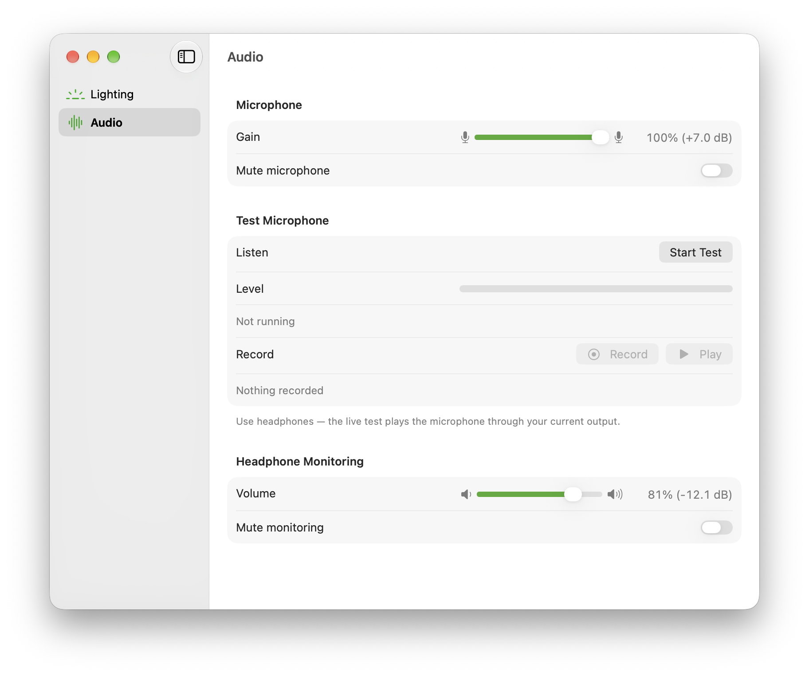

# MacMic

A native macOS menu bar app for the HyperX QuadCast S — RGB lighting, audio controls, and a live microphone test. HyperX only ships NGENUITY for Windows, leaving the mic on its default rainbow on macOS; MacMic fills that gap.

<p align="center">
  
  
</p>

## Features

- **RGB lighting** — **Solid** color (preset swatches, RGB sliders, hex input), **Rainbow Cycle**, and multi-color **Blink**, with speed and brightness controls. Settings persist across launches (each mode remembers its own colors and speed) and recover automatically on USB hotplug and sleep/wake.
- **Audio controls** — Microphone gain & mute and headphone-monitoring volume & mute, backed by Core Audio and kept in live sync with the mic's physical gain knob and System Settings → Sound.
- **Test Microphone** — Hear the mic live through your Mac's current output (AirPods, headphones, speakers) with an input level meter, or record up to 30 seconds in memory and play it back without plugging headphones into the mic itself. *(Use headphones for live pass-through to avoid speaker feedback.)*
- **Menu bar app** — Lives in the menu bar with no Dock icon (shows a slashed mic while muted), quick toggles for lighting, mode, and mute, and a single window (`⌘,`) for full Lighting and Audio controls.

## Install & Build

Requires **macOS 13 (Ventura)** or later and Xcode / Swift 5.9+. No notarized release is published yet — build from source:

```sh
git clone https://github.com/lavrovpy/macmic.git
cd macmic
./scripts/make-app.sh
open dist/MacMic.app
```

`scripts/make-app.sh` builds a universal (`arm64` + `x86_64`) release binary, assembles `dist/MacMic.app`, and ad-hoc signs it with the hardened runtime and microphone entitlement. Copy `dist/MacMic.app` to `/Applications` if you want to keep it installed.

For development and verification:

```sh
swift test                  # unit test suite
./scripts/test-make-app.sh  # shellcheck + bundle/signature verification
```

### Releasing

With a **Developer ID Application** certificate and `notarytool` credentials stored once (`xcrun notarytool store-credentials macmic-notary`), `scripts/release.sh` signs, notarizes, and staples `dist/MacMic.app`, zips `dist/MacMic-<version>.zip`, and writes the Homebrew cask to `dist/macmic.rb` (for the `lavrovpy/homebrew-tap` tap):

```sh
MACMIC_VERSION=1.0.0 \
MACMIC_SIGN_IDENTITY="Developer ID Application: <name> (<team id>)" \
./scripts/release.sh
```

## CLI

`macmic-cli` exposes lighting, audio controls, and hardware diagnostics from the terminal:

```sh
swift run macmic-cli probe                      # check matched USB functions and control transfers
swift run macmic-cli solid FF0000               # stream solid color until Ctrl-C (--brightness 0.0-1.0)
swift run macmic-cli cycle --speed 50           # rainbow cycle (--speed 0-100, --brightness 0.0-1.0)
swift run macmic-cli blink FF0000 0000FF        # blink through colors (--speed 0-100, --brightness 0.0-1.0)
swift run macmic-cli audio status               # show mic gain/mute and monitoring volume/mute
swift run macmic-cli audio gain 40              # set mic gain, 0-100 (also: audio mute on|off)
swift run macmic-cli audio monitor 30           # set monitoring volume, 0-100 (also: audio monitor-mute on|off)
swift run macmic-cli audio test --seconds 10    # live pass-through + level meter
swift run macmic-cli audio test --record 3      # record 3 s of the mic, play it back, and exit
```

## How It Works

- **Lighting (`IOUSBHost`)** — The QuadCast S has no onboard color memory; stopping the stream returns it to its default rainbow. `FrameStreamer` sends precomputed 64-byte header + RGB data packets every 55 ms. Because macOS's `IOHIDManager` cannot reach the mic's `0xFF0B` vendor usage page, `IOUSBHostTransport` seizes the USB device and sends raw `SET_REPORT` control transfers directly to PID `0x171f`.
- **Audio (`CoreAudio` HAL)** — Gain, mute, and headphone monitoring are standard USB Audio properties on PID `0x171d` (enumerated by macOS as separate 2-channel input and output devices), observed live and tracked independently of the lighting transport.
- **Test Microphone (`AVAudioEngine`)** — On macOS, `AVAudioEngine`'s input and output share a single HAL unit, so MacMic builds a private aggregate device pairing the QuadCast input with the system default output (rebuilding automatically when the output changes) and taps the input in memory for metering and clip recording.

For module architecture, conventions, and full hardware notes, see [`CLAUDE.md`](CLAUDE.md).

## Known Limitations

- Tested only on the **HyperX QuadCast S** (VID `0x0951`, PID `0x171f` / `0x171d`); QuadCast 2/2S and DuoCast are untested.
- Whole-mic color only (upper and lower zones match); no wave, lightning, or pulse presets; no launch-at-login yet.
- Polar pattern is a physical knob on the microphone and cannot be set in software.
- Test Microphone pins the mic's sample rate to match the output device (typically 48 kHz). If a Bluetooth headset (e.g. AirPods) is set as the macOS default *input*, starting the test can switch the headset into hands-free mode and interrupt capture — set the QuadCast S as the default input in System Settings → Sound to avoid this.
- Unsandboxed by necessity (USB device seizure + private aggregate audio devices) and distributed outside the Mac App Store.

## Credits & License

The RGB packet layout, timing, and preset formulas in `Sources/QuadcastKit/Protocol/` are ported from [QuadcastRGB](https://github.com/Ors1mer/QuadcastRGB) by Ors1mer (`reference/QuadcastRGB/`).

Licensed under **GPLv2-only**, matching upstream QuadcastRGB. See [LICENSE](LICENSE).
